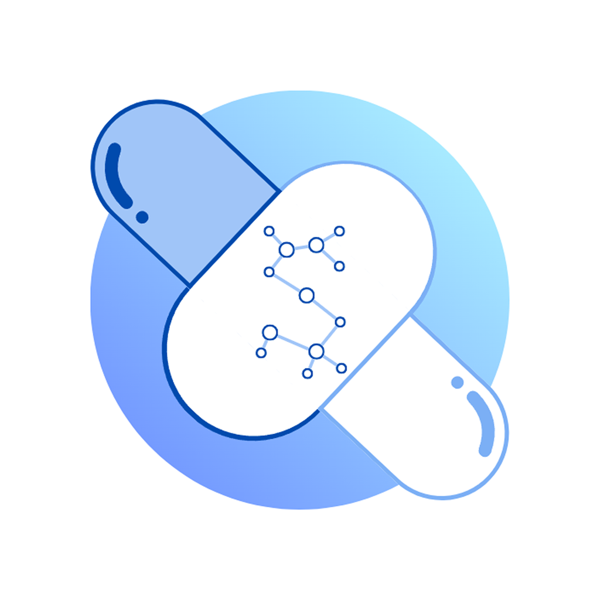

<p align="center">
  
</p>

<h1 align="center">Synapse</h1>

<p align="center"><strong>Your personal medical assistant for iPhone.</strong></p>

<p align="center">
  
  
  
  
  
</p>

<p align="center">
  
  
  
  
</p>

<p align="center">
  
  
  
  
</p>

Synapse keeps your health information in one place. Record your medical history and attach files, track your medicines and appointments, and get reminded when it's time for a dose or a check-up.

> Synapse is a personal organization tool. It does not diagnose, predict health outcomes or give medical advice, and it must not be relied on in an emergency.

---

## Table of contents

- [About](#about)
- [How the app works](#how-the-app-works)
- [Features](#features)
- [Reminders in detail](#reminders-in-detail)
- [Privacy and security](#privacy-and-security)
- [Tech stack](#tech-stack)
- [Project structure](#project-structure)
- [Getting started](#getting-started)
- [Database overview](#database-overview)
- [Troubleshooting](#troubleshooting)
- [Disclaimer](#disclaimer)

---

## About

Health information is usually scattered: lab results in a drawer, prescriptions in a photo album, appointment dates in a chat, and dosage instructions on a box that has already been thrown away. Synapse brings it together in one app on your iPhone.

With Synapse you can:

- **Keep a medical history.** Store lab results, prescriptions, imaging and other records, each with its own files.
- **Remember what matters about you.** Your blood group, birthdate, allergies and medical conditions are always one tap away.
- **Take medicines on time.** Add a medicine once and Synapse reminds you for every dose until the course ends.
- **Never miss a check-up.** See your appointments on a calendar and get a reminder 5 minutes before each one.

Your data is stored in your own account in the cloud, so it is restored when you log in on another iPhone.

---

## How the app works

1. **Welcome.** A splash screen, then an overview of what Synapse does.
2. **Create an account.** Enter your name, email and a password. Synapse emails you a **one-time code** to confirm the address. You can also **Continue with Google**.
3. **Tell Us About You.** A short onboarding: sex, blood group, birthdate, allergies and medical conditions. You only do this once.
4. **Use the app.** Three tabs:

| Tab | What you find there |
|---|---|
| 🏠&nbsp;**Home** | Your profile card (name, age, blood group), shortcuts to **Medical Records** and **Medicines**, and **Schedule For Today**. Basic Information is opened from the Medical Records screen. |
| 📅&nbsp;**Calendar** | A month calendar of your appointments. Add, view, edit and delete them. |
| 👤&nbsp;**Profile** | Edit your profile, **Data & Account** (email, password, clear data, delete account), **Notifications** and **Logout**. |

---

## Features

### Account and security
- Sign up with email and password, verified with a **one-time code (OTP)** sent by email. There are no verification links.
- Passwords need at least 8 characters, an uppercase letter, a lowercase letter and a special character.
- Log in with email and password, or **Continue with Google**.
- Forgot password with an emailed reset code.
- Codes can be resent after a **60-second** cooldown; expired and wrong codes show a clear message.
- Change your email (verified with a code) or password. Google accounts have no Synapse password, so these forms are replaced by a note.
- Delete your account; it can be restored by logging in again within **30 days**.
- Every user can only see and change their own data, enforced by Row Level Security in the database.

### Profile
- Edit your name, and upload, replace or remove a profile picture.
- Your age is calculated from your birthdate and shown on the Home screen with your blood group.

### Medical records
- Create records with a title, date, category (for example *Lab result*, *Prescription*, *Imaging*) and notes.
- Attach **photos and documents** from Photos or the Files app: JPG, PNG, HEIC, PDF, Word, Excel, Numbers, CSV, text and more.
- Thumbnails for images and an icon for each file type.
- Tap a file to preview it in the app (Quick Look). Long-press to **Open With…**, **Save to Files**, **Replace** or **Remove** it.
- The original file name, type and size are kept.
- **Search** by title, category, notes, date or file name.

### Basic information
- Allergies and medical conditions with an **Active / Inactive** status.
- **All / Active / Inactive** filters and search.

### Medicines
- Medication name, dosage, times per day (1–4), intake times, start and end date, and instructions.
- If you don't pick times, doses are spread across the day automatically:

  | Times per day | Default times |
  |---|---|
  | 1 | 8:00 |
  | 2 | 8:00, 20:00 |
  | 3 | 8:00, 14:00, 20:00 |
  | 4 | Every 4 hours from 8:00 |

- Activate or deactivate a medicine; filter by **All / Active / Inactive** and search the list.
- Swipe a medicine to edit, delete, activate or deactivate it.

### Appointments and calendar
- Title, doctor, location, start and end time, notes and status (**Scheduled / Completed / Cancelled**).
- Month calendar with dots on days that have appointments. Tap the month name to jump back to today.
- Tap an appointment for its full details, then edit or delete it.
- **Schedule For Today** on the Home screen lists today's appointments.

### Settings and data
- Turn all notifications, medicine reminders or appointment reminders on and off. Settings are saved to your account and restored on every device you log in to.
- **Clear Data** removes your records, medicines, appointments and basic information but keeps your account.
- Every delete, clear and logout action asks for confirmation first.

---

## Reminders in detail

Synapse uses local notifications on your iPhone, so reminders arrive even without an internet connection.

- **Medicines:** one notification for each dose, following the times per day (1 to 4). Reminders stop automatically when a medicine is deactivated, deleted, or its end date passes.
- **Appointments:** one notification **5 minutes before** each *Scheduled* appointment. Completed or cancelled appointments are not reminded.
- **Always up to date:** editing a medicine or appointment, changing its status, or switching a reminder type off updates the pending notifications immediately. Each reminder has a fixed ID, so you never get duplicates.
- **iOS limit:** iOS allows an app only 64 pending notifications. Synapse keeps a rolling window: upcoming appointments come first, then the nearest medicine doses over the next 14 days. The window is refilled every time you open the app.

> Tip: open Synapse at least once every few days, so the reminder window stays full.

---

## Privacy and security

- **Your data is yours only.** Every table and storage bucket uses Supabase Row Level Security, so a user can read and change only rows and files that belong to their own account.
- **Private files.** Profile pictures and attachments are stored in private buckets, in a folder named after your user ID. The app shows them through signed links that expire after a short time.
- **Verified emails.** Accounts can't reach the app until the email address is confirmed with a code.
- **No secret keys in the app.** The app only contains Supabase's public *anon* key. The `service_role` key must never be added to the app.
- **No tracking.** Synapse has no analytics or advertising SDKs.

---

## Tech stack

| | |
|---|---|
| Platform | iOS (iPhone), version 1.0 |
| Language / UI | Swift, SwiftUI |
| Architecture | **MVC** (Models, Views, Controllers) |
| Backend | [Supabase](https://supabase.com): Auth, PostgreSQL, Storage |
| SDK | [supabase-swift](https://github.com/supabase/supabase-swift) 2.55+ (Swift Package Manager) |
| Notifications | Apple UserNotifications (local notifications) |
| File preview | Quick Look |
| Fonts | Graduate, DM Sans |

---

## Project structure

```
Synapse/
├── Synapse.xcodeproj
├── Synapse/
│   ├── SynapseApp.swift          App entry point and notification setup
│   ├── Models/                   Data types, one per file (UserProfile, Appointment, MedicineInformation…)
│   ├── Controllers/              Logic: auth, database, storage and notifications
│   │   ├── SupabaseManager.swift Supabase client, table and bucket names
│   │   ├── SessionController.swift
│   │   ├── NotificationController.swift
│   │   └── …one controller per screen or feature
│   ├── Views/                    One file per screen (LoginView, HomeView, CalendarView…)
│   │   ├── Components/           Shared UI: inputs, buttons, headers, fonts and colors
│   │   ├── Popups/               The confirmation pop-up used for logout, delete and clear
│   │   └── Fonts/
│   └── Assets.xcassets
├── supabase/
│   ├── schema.sql                Tables, indexes, triggers, RLS and storage policies
│   └── SETUP.md                  Full backend setup guide
└── docs/
    └── logo.png                  Logo used in this README
```

**How MVC is applied:**
- **Models** are plain data types that match the database tables.
- **Views** only show data and forward user actions.
- **Controllers** do the work: they talk to Supabase, validate input and schedule notifications.

**Screens and their controllers:**

| Screen | Controller(s) |
|---|---|
| RootView (chooses the current screen) | SessionController |
| LoginView | LoginController |
| CreateAccountView | CreateAccountController |
| OTPVerificationView | OTPVerificationController |
| ForgotPasswordView | PasswordResetController |
| AboutYouView (onboarding) | AboutYouController |
| HomeView | HomeController, AppointmentController |
| CalendarView | CalendarController, AppointmentController |
| MedicinesView | MedicineController |
| MedicalRecordView, MedicalRecordDetailView | MedicalRecordController, AttachmentController |
| AttachmentsView | AttachmentController |
| BasicInformationView | BasicInformationController |
| ProfileView, EditProfileView, ChangeEmailView, ChangePasswordView, DataAccountView | ProfileController |
| SettingsView (notifications) | SettingsController |

`NotificationController` schedules every local notification, and `SupabaseManager` holds the single Supabase client.

---

## Getting started

### Requirements
- A Mac with **Xcode 26** or later.
- An iPhone or simulator running **iOS 26.5** or later.
- A free [Supabase](https://supabase.com) account.

### 1. Clone the project
```bash
git clone https://github.com/mariarosa09/Synapse.git
cd Synapse
open Synapse.xcodeproj
```
Xcode downloads the Supabase package automatically. If it doesn't, use **File → Packages → Resolve Package Versions**.

### 2. Set up Supabase
1. Create a project at [supabase.com/dashboard](https://supabase.com/dashboard).
2. Open **SQL Editor**, paste the contents of `supabase/schema.sql` and click **Run**. This creates every table, security rule and storage bucket.
3. Configure email OTP. Under **Authentication**:
   - turn **Confirm email** on;
   - turn **Secure email change** off;
   - edit the email templates so they show the code (`{{ .Token }}`) instead of a link.
4. Add your own SMTP server (for example Gmail with an App Password) so codes can be sent reliably.

Step-by-step instructions, ready-to-paste email templates and Google sign-in setup are in **[`supabase/SETUP.md`](supabase/SETUP.md)**.

### 3. Connect the app to your project
In `Synapse/Controllers/SupabaseManager.swift`, set your project's values from **Project Settings → API**:
```swift
static let url = URL(string: "https://YOUR-PROJECT-REF.supabase.co")!
static let anonKey = "YOUR-ANON-PUBLIC-KEY"
```
The anon key is meant to be public; your data is protected by Row Level Security. **Never** put the `service_role` key in the app.

### 4. Run
Choose an iPhone or simulator and press **⌘R**. Allow notifications when asked, so reminders work.

---

## Database overview

| Table | Contents |
|---|---|
| `profiles` | Name, email, profile picture path, sex, blood group, birthdate |
| `user_settings` | Notification preferences |
| `basic_information` | Allergies and medical conditions |
| `medicines` | Medicines, dosage and intake times |
| `appointments` | Appointments and their status |
| `medical_records` | Medical records |
| `medical_record_attachments` | File name, type, size and storage path of each attachment |

**Storage buckets** (both private):
- `avatars`: profile pictures.
- `medical-records`: record attachments.

Files are stored in a folder named after the user's ID and shown through short-lived signed URLs.

---

## Troubleshooting

| Problem | Fix |
|---|---|
| "A server with the specified hostname could not be found" | The Supabase project is **paused**. Free projects pause after about a week without use. Open the dashboard and click **Restore project**. |
| "Error sending confirmation email" | The SMTP settings are wrong. Check the username, the App Password and the sender email in **Authentication → Emails → SMTP Settings**. |
| The verification email contains a link instead of a code | Edit the email templates to use `{{ .Token }}` (see `supabase/SETUP.md`). |
| "Continue with Google" says "not set up yet" | Enable the Google provider in **Authentication → Sign In / Providers** (see `supabase/SETUP.md`). |
| No new code arrives when I tap Resend | Wait for the 60-second cooldown to end. Supabase also rate-limits emails; check the spam folder. |
| Reminders don't appear | Allow notifications for Synapse in iOS **Settings → Notifications**, and check the toggles in the app's **Profile → Notifications**. |
| Some medicine reminders are missing far in the future | Open the app: the 64-notification window is refilled every time Synapse becomes active. |

---

## Disclaimer

Synapse stores and organizes information that you enter yourself. It is not a medical device and does not replace advice from a healthcare professional. Reminders depend on your device's notification settings; do not rely on Synapse as your only reminder for critical medication.
